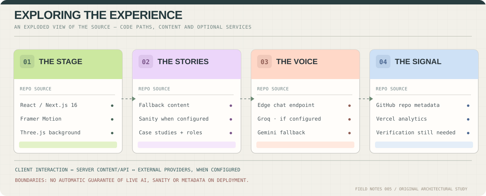

### HULAX STUDIO / FIELD JOURNAL 005

**An interface can show the outcome. A studio journal can show the thinking.**

The source behind [**Rahul Khanke's portfolio**](https://portfolio.hulax.uk/): interactive work, visual experiments, documented engineering decisions and four distinct project worlds.

**[Open the portfolio](https://portfolio.hulax.uk/)** · **[Explore the Making Of](https://portfolio.hulax.uk/studio)** · **[Visit the Project Constellation](https://portfolio.hulax.uk/constellation)**

The artwork is a bespoke conceptual design contact sheet—not an actual browser screenshot or a performance measurement.

---

## The idea behind the interface

The portfolio is the public exhibit. This repository is the studio: the layers and decisions that make the exhibit work.

It connects **data science, AI engineering and creative frontend work** without reducing every project to the same template. That matters because a fraud investigation, a delivery optimizer, a market-analysis system and a music-library tool solve fundamentally different problems.

> **Make the work understandable. Make the experience memorable. Show the implementation honestly.**

This portfolio belongs to **Rahul Khanke**, an MSc Data Science graduate of the **University of Glasgow (2025)**, with a software engineering background. It is both a personal portfolio and a place to experiment with interactive storytelling.

## Plate 01 / The making-of journal

**[Enter the studio →](https://portfolio.hulax.uk/studio)**

The studio is a dedicated, responsive editorial page exploring how the site fits together. Its four annotated studies link to **actual implementation files**:

| Studio note | What it investigates | Source |
| :--- | :--- | :--- |
| **01 / The stage** | Design, animation, season changes and Three.js depth | [ThreeBackground.jsx](src/components/ThreeBackground.jsx) · [RevealOnScroll.jsx](src/components/RevealOnScroll.jsx) |
| **02 / The stories** | Curated projects, fallback data and optional Sanity content | [content-service.js](src/lib/cms/content-service.js) · [fallbackContent.js](src/data/fallbackContent.js) |
| **03 / The voice** | Model-assisted portfolio Q&A and provider fallbacks | [chat API route](src/app/api/chat/route.js) · [AIChatWidget.jsx](src/components/AIChatWidget.jsx) |
| **04 / The feedback loop** | Public GitHub metadata and Vercel instrumentation | [constellation route](src/app/constellation/page.jsx) · [root layout](src/app/layout.js) |

The studio itself is implemented in [the Studio page](src/app/studio/page.jsx), with [responsive editorial styling](src/app/studio/studio.module.css).

## Plate 02 / The layers beneath the experience

Architecture illustration based on the current source. Optional integrations are shown as optional; this is not a live system-health dashboard.

**What is present in source:**

- **Presentation:** Next.js 16 / React 19, Framer Motion, Three.js, a season-aware theme system and interactive visual components.
- **Content:** curated project/case-study records with an **optional Sanity CMS** path and checked-in fallbacks.
- **AI:** an API route that attempts a configured **Groq** model with a **Gemini fallback** if available. The model answers from curated context; a vector-database retrieval pipeline is **not established by this route**.
- **Project signals:** the constellation can fetch public GitHub repository metadata, caching results when available; repository links remain usable without the signal.
- **Instrumentation:** the layout includes Vercel Analytics and Speed Insights components; this is not a claim about a measured Lighthouse score.

For the actual integration logic, start with [layout.js](src/app/layout.js), [content-service.js](src/lib/cms/content-service.js) and [api/chat/route.js](src/app/api/chat/route.js).

## The project exhibit / Four different worlds

<table>
<tr>
<td width="50%" valign="top">

**01 / [Sentinance](https://github.com/HuLaxx/Sentinance) — The Signal Atlas**

An AI market observatory: streaming data, model experiments and interpreted research signals.

[Portfolio case](https://portfolio.hulax.uk/case/sentinance) · [Technical story](https://github.com/HuLaxx/Sentinance#readme)

</td>
<td width="50%" valign="top">

**02 / [GraphGuard](https://github.com/HuLaxx/GraphGuard) — The Evidence Graph**

An investigative casefile: relationship graphs, ML risk scoring, model explanations and analyst review.

[Portfolio case](https://portfolio.hulax.uk/case/graphguard) · [Technical story](https://github.com/HuLaxx/GraphGuard#readme)

</td>
</tr>
<tr>
<td width="50%" valign="top">

**03 / [FleetFlow](https://github.com/HuLaxx/FleetFlow) — The Dispatch Atlas**

A dispatcher’s route worksheet: order manifests, vehicle constraints, route proposals and operational events.

[Portfolio case](https://portfolio.hulax.uk/case/fleetflow) · [Technical story](https://github.com/HuLaxx/FleetFlow#readme)

</td>
<td width="50%" valign="top">

**04 / [Shiftify](https://github.com/HuLaxx/Shiftify) — The Music Passport**

A music-library product study: portable tracklists, reviewed records and clear credential boundaries.

[Portfolio case](https://portfolio.hulax.uk/case/shiftify) · [Technical story](https://github.com/HuLaxx/Shiftify#readme)

</td>
</tr>
</table>

The [**Project Constellation**](https://portfolio.hulax.uk/constellation) connects these projects by **shared engineering disciplines**, not invented runtime dependencies.

## Open the studio locally

Install a version of Node.js supported by Next.js 16, then:

~~~bash
git clone https://github.com/HuLaxx/my-portfolio.git
cd my-portfolio
npm ci
npm run dev
~~~

Open [**http://localhost:3000**](http://localhost:3000).

Useful routes: [Home](http://localhost:3000) · [Making Of](http://localhost:3000/studio) · [Project Constellation](http://localhost:3000/constellation) · project case studies at \`/case/<slug>\`.

### Optional integrations

| Feature | What it needs | What happens without it |
| :--- | :--- | :--- |
| **Sanity CMS** | Sanity project, dataset and relevant environment variables | Checked-in fallback content is used |
| **AI chat** | \`GROQ_API_KEY\`; optional \`GOOGLE_GENERATIVE_AI_API_KEY\` for failed-Groq fallback | API chat reports a configuration error |
| **GitHub constellation signals** | Access to public GitHub repo metadata API | Project navigation still works, but freshness/language signals may be unavailable |
| **Vercel Analytics** | A correctly configured deployment for observable data | Package presence alone does not establish tracked analytics |

**Data/privacy boundary:** chat questions may be sent to the configured external AI provider. Do not send secrets or private documents to the demo chat.

### Quality commands

~~~bash
npm run lint
npm run build
~~~

These commands are provided for reproduction. **Current lint/build status has not been verified as part of the graphic and README redesign.**

## Ongoing studio notes

- [x] Build original contact-sheet and source-backed architecture artwork.
- [x] Add a dedicated responsive [Making Of studio page](src/app/studio/page.jsx).
- [x] Expose a link to the journal from the main Projects section.
- [x] Remove outdated biography, stack and profile-link references from this README.
- [x] Clearly distinguish configured services from guaranteed live behaviour.
- [ ] Test the current production build, browser accessibility and mobile layout.
- [ ] Benchmark animation and 3D performance on constrained devices.
- [ ] Verify live domain and case-study routing after deployment.
- [ ] Review image/audio licensing and third-party asset permissions for public hosting.
- [ ] Audit supporting résumé/project performance claims against reproducible evidence before treating metrics as verified.

[**Open the repo-specific makeover checklist**](docs/CREATIVE_CHECKLIST.md).

---

### DESIGN IS THE DOOR. ENGINEERING IS WHAT OPENS IT.

**Rahul Khanke / HuLaX** · [Portfolio](https://portfolio.hulax.uk/) · [GitHub](https://github.com/HuLaxx) · [LinkedIn](https://www.linkedin.com/in/rahul-khanke-853717218/) · [Email](mailto:rahulkhanke786@gmail.com)

Four projects, four visual dialects, one studio learning in public.

